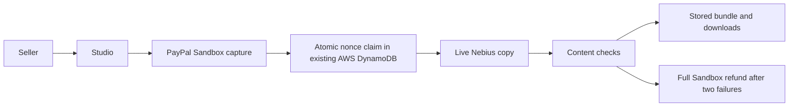

# Paid Agent Studio

Turn supplied product facts into English or Korean content, with PayPal Sandbox checkout and a refund after two failed content checks.

**[Try it](https://paid-agent-studio.vercel.app)** · [Source](https://github.com/kks0488/paid-agent-studio)

- Choose a fixed-price package: product page, ads, short video script, and optional listing review.
- Pay with a PayPal Sandbox buyer or Sandbox guest test card, then generate live Nebius copy.
- Download Markdown/JSON and inspect the payment, quality-check, and refund timeline.

Use fictional product facts. All payments are Sandbox test transactions. For guest checkout, generate a fresh card with PayPal’s [Sandbox card generator](https://developer.paypal.com/sandbox-testing/card-testing/). Never use a real card or account. If guest checkout is unavailable, use a Sandbox personal buyer. The labeled refund scenario deliberately fails both checks.



Sponsor technology:
- PayPal Orders v2 creates, retrieves and captures orders; Payments v2 retrieves captures/refunds and refunds the original capture. Server rules fix prices and refund eligibility; financial POST requests retain stable idempotency keys. Webhook signatures are verified through PayPal.
- [Nebius Token Factory](https://docs.tokenfactory.nebius.com/quickstart) supplies OpenAI-compatible structured generation. English/Korean copy uses only seller facts; no-key mode is clearly labeled deterministic demo content.

Quick start (Node 22; build and browser work on pilot):

```sh
npm ci
cp .env.example .env.local
npm test
npm run build
npm start
```

Configure PayPal Sandbox credentials, signing secret and webhook ID, plus `LLM_BASE_URL`, `LLM_API_KEY`, `LLM_MODEL`. `STATE_URL` and `STATE_SECRET` connect to the authenticated CAS endpoint in the existing Shorts QC AWS deployment (`infra/api.py`, `CommerceStateSecrets` parameter). No new account is required. Keep all credentials server-side; `.env.example` contains empty values.

Each job has a one-time nonce bound to the signed specification, PayPal order and capture. An atomic server record claims generation and stores the final bundle. Old receipts recover that result, without another model call or automatic refund. Successful delivery blocks automatic refunds; downloading records acceptance. Current PayPal capture/refund state is checked before fulfillment/refund/download. Financial records do not expire. Storage outages and interrupted generation fail closed; interrupted jobs need seller review. Legacy receipts without a nonce cannot initiate work or refunds.

Receipts are signed, not encrypted, and tied to the browser cookie. Keep this browser for recovery. This is a Sandbox prototype, not a live-money service. Automated copy checks cannot establish every product claim; sellers review copy before publishing.

Tests cover pricing, payment identity, webhook signatures, receipts, replay after a process reset, concurrent nonce claims, acceptance, refunds and provider failures. GitHub Actions runs tests, build and secret scanning. Real screens are in `media/`; live English/Korean samples are saved outside the repo in `hackathons/paypal/samples/`. A public narrated video remains a separate owner task.

## What was built during the hackathon

Studio UI, fixed-price packages, constrained PayPal tools, verified webhooks, live structured copy, source/claim checks, nonce-protected fulfillment, browser ledger, exports, tests, CI and deployment. The prompt/parser base reuses our own MIT commerce-content-engine code.

[MIT](LICENSE) · Copyright (c) 2026 Kyoungsoo Kim.
