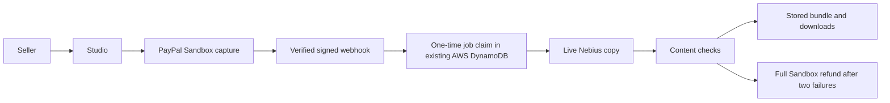

# Paid Agent Studio

Turn product facts into English or Korean content, with PayPal Sandbox checkout and a refund after two failed content checks.

**[Try it](https://paid-agent-studio.vercel.app)** · [Source](https://github.com/kks0488/paid-agent-studio)

- Choose a fixed-price product page, ad copy and short-video script package.
- Pay through PayPal Sandbox, then generate and review live Nebius content.
- Download Markdown/JSON and inspect the payment, content-check and refund timeline.

Use fictional product facts and Sandbox test payments. To try guest checkout:

1. Get a quote, choose **Continue to PayPal Sandbox**, then **Sandbox guest card checkout**.
2. Generate a US Visa test card with PayPal’s [Sandbox card generator](https://developer.paypal.com/sandbox-testing/card-testing/). Use fictional US billing details and select guest checkout without creating an account.
3. Pay with the test card and return to the Studio. The signed payment webhook starts generation; the result appears automatically. Download Markdown or JSON.

No real money moves. A Sandbox personal buyer is an alternative. The labeled refund scenario deliberately fails both checks.



Sponsor technology:

- **PayPal Orders v2 / Payments v2:** Sandbox orders, captures and refunds, stable idempotency keys, and verified webhook signatures.
- **[Nebius Token Factory](https://docs.tokenfactory.nebius.com/quickstart):** live Nemotron English/Korean drafts and corrections. Still-rejected fields can use disclosed source rules, followed by another check. Missing keys select labeled demo fixtures.

## Quick start

Node 22. Run installs, builds and browser checks on pilot/Linux.

```sh
npm ci
cp .env.example .env.local
npm test
npm run build
npm start
```

Fill `.env.local` with Sandbox credentials, webhook ID, signing secret and `LLM_BASE_URL`, `LLM_API_KEY`, `LLM_MODEL`. `STATE_URL`/`STATE_SECRET` use our existing Shorts QC AWS CAS endpoint (`CommerceStateSecrets`). Secrets stay server-side.

One-time claims bind each brief, order and capture. Stored checkouts survive restarts; old receipts recover results without regenerating or refunding delivered work. Current PayPal state is checked before fulfillment, refunds and downloads. Completion records do not expire.

Keep the same browser for recovery. Interrupted jobs need seller review. Content checks cover specified patterns; review drafts before publishing.

GitHub Actions runs tests, build and secret scans. Production screenshots: `media/`. Raw results/video: `hackathons/paypal/` outside this repo. Owner: upload video and submit Devpost.

## What was built during the hackathon

Studio UI, fixed-price packages, PayPal tools/webhooks, live structured copy, source/claim checks, durable fulfillment, browser ledger, exports, tests, CI and deployment. The prompt/parser base reuses our own MIT commerce-content-engine code.

[MIT](LICENSE) · Copyright (c) 2026 Kyoungsoo Kim.
