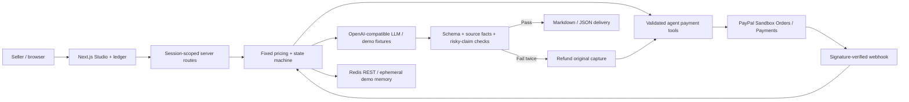

# Paid Agent Studio

An agent that sells, gets paid for, delivers, and guarantees its own commerce content.

**[Try the hosted demo](https://paid-agent-studio.vercel.app)** · [Source](https://github.com/kks0488/paid-agent-studio) · MIT

Small sellers need product pages, ads, and short video scripts. The quote → payment → follow-up → delivery loop costs more time than the writing. Paid Agent Studio turns supplied product facts into a fixed-price job, collects payment through PayPal, generates the content, checks it, and delivers downloadable Markdown and JSON. If two checks fail, it requests a full refund automatically.

## Try it in two minutes

1. Keep the fictional Forma tote brief or paste your own product facts.
2. Choose Starter ($19), Launch ($39), or Growth ($69), then request a quote.
3. Complete the explicitly simulated checkout. No money moves.
4. Generate the bundle, inspect the quality checks and tool timeline, and download the files.
5. Start another job with the guarantee demonstration enabled. Both content attempts fail the risky-claim check and the simulated payment is refunded. Open the ledger to compare the two jobs.

The hosted build uses **simulated PayPal payments and live Nebius AI**. PayPal Sandbox credentials are still unavailable, so no money moves. Provider failures in simulated orders visibly switch to deterministic fixtures; they are never reported as live success. Demo data is private to an anonymous browser session and may disappear when the server restarts. It is a working prototype, not a production payment service.

## How PayPal and AI are used

PayPal is central to the workflow: Orders v2 creates a server-priced checkout, the JavaScript SDK obtains buyer approval in Sandbox, the backend captures and verifies the order, and Payments v2 refunds the original capture if both content attempts fail. Webhook notifications are sent to PayPal's signature-verification endpoint before any order state changes. The agent timeline records the payment tool, endpoint, outcome, and reason.

The agent exposes four narrowly scoped tools: `create_order`, `get_order`, `capture`, and `refund`. We reviewed the [PayPal Agent Toolkit](https://github.com/paypal/agent-toolkit) and [MCP resources](https://developer.paypal.com/ai-tools/get-started). This prototype uses its own validated tool layer so the model cannot choose arbitrary amounts, recipients, or refund eligibility. The workflow is orchestrated by server policy; the LLM explains the quote and creates content, rather than deciding how much money to move.

With `LLM_API_KEY`, an OpenAI-compatible model generates quote explanations and structured content from the seller's facts. The default target is [Nebius Token Factory](https://docs.tokenfactory.nebius.com/quickstart) at `https://api.tokenfactory.nebius.com/v1/`. `LLM_BASE_URL` and `LLM_MODEL` also support other compatible providers. Gemini [OpenAI compatibility](https://ai.google.dev/gemini-api/docs/openai) can use `https://generativelanguage.googleapis.com/v1beta/openai/` with an available Gemini model. Without a key, transparent deterministic fixtures use the entered facts.

## Live mode

Production uses `LLM_BASE_URL=https://api.tokenfactory.nebius.com/v1` and `LLM_MODEL=nvidia/Nemotron-3_5-Lightning`; `LLM_API_KEY` exists only in Vercel environment storage. Changing the key requires a production redeploy. No key is sent to the browser.

The client disables model thinking with `chat_template_kwargs: {"enable_thinking": false}` and `/no_think`, reads final `message.content` only, strips `<think>` blocks, and requests JSON objects for content bundles. Quote calls allow 512 tokens / 20 seconds; content calls allow 5,000 tokens / 45 seconds. Tolerant JSON extraction accepts surrounding fences or prose. Empty, truncated, invalid, and timed-out responses fail safely. Orders report `quoteMode`, `aiMode`, `aiNotice`, and real provider usage in `llmUsage` so judges can distinguish live output from fixtures. Quote fallback and simulated content fallback are visible in the Studio; real paid Sandbox jobs preserve QC/refund behavior instead of delivering fixtures.

Live production verification on October 16, 2026 passed: live quote explanation, live structured content after one QC rewrite, simulated checkout, downloads, refund demonstration, ledger, session isolation, and mobile layout. The final capture used four calls / 3,021 reported tokens with zero reasoning tokens. Across the metered diagnostic and final runs, usage was 5,861 tokens; an earlier failed browser run made up to three additional calls whose usage was not retained. See [`media/verification.json`](media/verification.json) for final-run usage and [`media/02-quote.png`](media/02-quote.png) / [`media/03-delivery.png`](media/03-delivery.png) for live results. All five desktop captures are 1920×1080; the sixth is the mobile check. Refund imagery intentionally demonstrates fixtures and simulated payments.

PayPal payments remain simulated until the owner supplies the Sandbox keys, webhook registration, and durable storage listed below. The intentional refund demonstration always uses fixtures.

## Architecture



## Run and test

Requires Node.js 22. Do dependency installation, builds, servers, and browsers on a machine with sufficient memory; this job used `pilot`.

```sh
npm ci
cp .env.example .env.local
npm test
npm run build
npm start
# http://localhost:3000
```

The app works without keys. Run `npm run dev` for development. Next.js reads `.env.local`; plain `npm test` uses isolated mocked payments and does not need credentials. The [GitHub Actions workflow](.github/workflows/ci.yml) runs tests, a production build, and secret scans.

### Enable PayPal Sandbox

1. The owner creates or accesses their free [PayPal Developer Sandbox app](https://developer.paypal.com/dashboard/applications/sandbox).
2. Set `PAYPAL_CLIENT_ID`, `PAYPAL_CLIENT_SECRET`, and `PAYPAL_ENV=sandbox` on the server. Never use `NEXT_PUBLIC_` variables for secrets.
3. Register `https://<your-host>/api/webhooks/paypal` and copy its ID into `PAYPAL_WEBHOOK_ID`. Subscribe to `PAYMENT.CAPTURE.COMPLETED` and `PAYMENT.CAPTURE.REFUNDED`.
4. Set `REDIS_REST_URL` and `REDIS_REST_TOKEN` for an existing Upstash-compatible Redis REST service. Sandbox checkout fails closed without durable storage and a webhook ID. Credential presence selects Sandbox automatically; partial configuration returns a clear error.
5. Redeploy, check the Sandbox badge, and approve checkout with a separate Sandbox buyer account. Sandbox is the only enabled payment environment. The forced refund demonstration is restricted to simulated payments.

No account is created or paid service purchased by this project. Keys and the Redis token remain server-side. The public client ID is returned only for the Sandbox SDK.

### Browser checks and demo captures

Run a production server on `pilot`, then use the installed Playwright package:

```sh
PLAYWRIGHT_MODULE=/home/pilot/workspace/hackathons/qloo/node_modules/playwright/index.mjs \
  PLAYWRIGHT_CHROMIUM_PATH=/home/pilot/.cache/ms-playwright/chromium-1228/chrome-linux64/chrome \
  BASE_URL=http://127.0.0.1:3000 npm run test:e2e
```

Verified on `pilot`: 38 Node tests pass, the production build passes, and both visible simulated delivery/refund flows pass Playwright at 1920×1080, with a 390px layout check and real download. Dependency audit reports zero known vulnerabilities. The same browser flow also passes against the public Vercel URL. See [`media/verification.json`](media/verification.json).

`scripts/capture.mjs` checks the successful order, exports, automatic refund, ledger, session isolation, and mobile layout. Small real-app screenshots are in `media/`; larger raw browser video is stored in `~/projects/02_업무_자동화/upwork/hackathons/paypal/capture/` and is not committed. A public YouTube video under three minutes is still an owner/shared-video-kit step; this repository does not claim to have uploaded or submitted one.

## Payment and quality boundaries

- Prices are immutable server rules in USD: Starter $19, Launch $39, Growth $69. Browser amounts are ignored. Delivery includes only the purchased package's sections.
- Session-scoped order access uses a random HttpOnly, SameSite cookie. Cross-origin mutations and oversized JSON bodies are rejected. Requests and quote creation are rate limited.
- Per-order locks, stable `PayPal-Request-Id` values, stored order states, and replay detection protect retries. Completed payment amounts, currency, capture identity, and order identity are checked before fulfillment.
- Refund eligibility requires a captured payment and two failed attempts. A failed or pending refund is shown honestly; a request is not reported as a completed refund.
- QC is a conservative automated screen for schema problems, unsupported numeric/product facts, and risky claims. It is not a comprehensive truth or legal certification. Sellers should review content before publishing.
- The hosted no-key demo uses process memory: cold starts and concurrent instances may lose or disagree on orders. Durable Redis is required before accepting Sandbox transactions. Browser sessions are anonymous and have no account recovery; this prototype does not provide a merchant-wide authenticated dashboard.
- Verified capture webhooks schedule generation after the HTTP response through Next.js `after()`. This is bounded by the function lifetime, not a durable job queue; interrupted paid jobs can be resumed from the ledger, and webhook retries can resume them.
- Live Sandbox checkout, webhook delivery, and refunds require owner credentials and remain unverified until those are provided. LLM inference uses the configured Nebius provider. No actual money is accepted by this prototype.

## What was built during the hackathon

Built in October 2026: the Studio interface, package quoting, guarded agent tool orchestration, PayPal create/get/capture/refund adapters, JavaScript SDK checkout integration, verified webhooks, retry and refund policy, QC pipeline, session order ledger, downloads, tests, CI, deployment, and demo capture workflow. Continuous integration is configured in `.github/workflows/ci.yml`.

Reused our own MIT-licensed `commerce-content-engine/src/core.js` as `lib/content-core.js` for input normalization, model prompts, provider calls, bundle parsing, and Markdown formatting. The rest of the application is new. UI illustrations are original CSS/SVG; no scraped product content, third-party logos, or copyrighted demo media are included. Runtime dependencies are listed in `package.json`.

Built with: Next.js App Router, React, Node.js, PayPal REST APIs and JavaScript SDK, optional Nebius/Gemini-compatible inference, Redis REST, Playwright, GitHub Actions, Vercel, and Gitleaks. Codex built the implementation from the owner's brief. The original no-key run used fixtures; the live-mode verification is described above.

The [hackathon rules](https://paypalaihackathon.devpost.com/rules) require a meaningful PayPal + AI integration, a public open-source repository, a functional demo, tools disclosure, and a public YouTube demo under three minutes. Submission deadline: November 12, 2026, 12:00 PST. No Devpost submission is performed by this repository.

## Official integration references

- [Orders v2 create / capture](https://developer.paypal.com/api/orders/v2)
- [Payments v2 capture refunds](https://developer.paypal.com/api/payments/v2)
- [JavaScript SDK reference](https://developer.paypal.com/sdk/js/reference/)
- [Webhook verification](https://developer.paypal.com/api/rest/webhooks/rest/)
- [Hackathon resources](https://paypalaihackathon.devpost.com/resources)

## License

[MIT](LICENSE) · Copyright (c) 2026 Kyoungsoo Kim.
