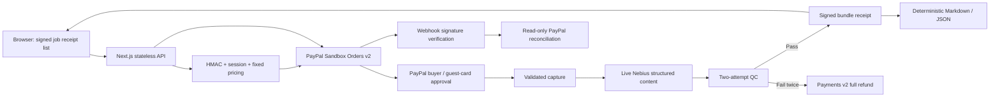

# Paid Agent Studio

An agent that quotes, sells, delivers, and guarantees commerce content with PayPal Sandbox and live Nebius AI.

**[Try it](https://paid-agent-studio.vercel.app)** · [Source](https://github.com/kks0488/paid-agent-studio) · MIT

Small sellers need product pages, ads, and short video scripts. Coordinating the quote, payment, writing, quality checks, delivery, and refunds takes time. Paid Agent Studio handles that workflow from a seller's supplied facts, with fixed prices and a two-attempt quality guarantee.

## Try it

1. Keep the fictional Forma tote brief or enter product facts. Choose Starter ($19), Launch ($39), or Growth ($69).
2. Request a quote. The scope explanation uses live Nebius; prices remain server rules.
3. Continue to PayPal Sandbox. Either use your own **Sandbox personal buyer**, or select **Sandbox guest card checkout**. Never enter a real PayPal login or real card.
4. On PayPal's [public Sandbox card generator](https://developer.paypal.com/sandbox-testing/card-testing#credit-card-generator), select Visa and United States, then generate a **fresh test card**. On the Sandbox guest form, use its number, expiry, and CVV, country United States, name **Sandbox Buyer**, address **123 Test Street, San Jose, CA 95131**, phone **2025550123**, and a fictional email such as **sandbox-guest@example.com**. If PayPal asks whether to create an account, select **No, not now**; then **Pay now as guest** or **Pay Now**, without creating an account.
5. Returning to the Studio captures and checks the real Sandbox payment. Select **Create my content bundle** for live generation, QC, and Markdown/JSON delivery.
6. For a real Sandbox refund, enable **Try the refund guarantee** before requesting a second quote. After payment, two content attempts receive an explicit Sandbox QC failure injection, triggering a full refund of that capture.
7. Open the ledger to inspect PayPal order, capture, and refund IDs. Keep the same browser and cookies for recovery.

All payments are **Sandbox test transactions**, with no actual money. The merchant currently rejects direct Orders API card processing with `PAYEE_NOT_ENABLED_FOR_CARD_PROCESSING`; standard PayPal guest checkout with a freshly generated card is the alternative. The shared static card `4012888888881881` was rejected by guest checkout and should not be reused there. The optional direct API test-card route reports that error honestly.

A default Sandbox personal account is managed in the [Developer Dashboard](https://developer.paypal.com/dashboard/accounts). No supported merchant REST API for listing/creating buyers or retrieving their passwords was found in PayPal's public API catalog. If guest checkout is unavailable for a judge's location, the owner must copy the default Sandbox buyer email/password from **Testing Tools → Sandbox Accounts → View/Edit Account**, or judges can use their own Sandbox buyer. No buyer password is included in this repository.

## PayPal and AI integration

PayPal is the financial source of truth: Orders v2 creates and retrieves orders, buyer approval happens on PayPal, the server captures, and Payments v2 refunds the original capture after two failed quality checks. Stable `PayPal-Request-Id` values protect repeated financial requests. PayPal `custom_id` links the job; `invoice_id` also binds a digest of its immutable signed specification, price, currency, and browser owner.

The agent exposes narrowly scoped `create_order`, `get_order`, `capture`, and `refund` tools. The model cannot select arbitrary amounts, recipients, or refund eligibility. Timeline entries show API paths and real resource IDs. We reviewed the [PayPal Agent Toolkit](https://github.com/paypal/agent-toolkit); this app implements its own constrained REST tool layer.

The registered Sandbox webhook is `https://paid-agent-studio.vercel.app/api/paypal/webhook`, subscribed to `CHECKOUT.ORDER.APPROVED`, `PAYMENT.CAPTURE.COMPLETED`, and `PAYMENT.CAPTURE.REFUNDED`. The listener calls PayPal's **verify-webhook-signature** API, then reconciles the actual PayPal order before acknowledging. Replays are harmless: the listener performs read-only reconciliation and never treats an in-memory flag as durable evidence. Safe structured runtime logs contain only verified event IDs/types and order IDs, never credentials or payloads. The legacy `/api/webhooks/paypal` route remains compatible.

Webhook receipt verifies payment independently. The browser resumes content generation with its signed job specification; a webhook alone cannot recover a browser-held private brief or start a durable background job. The optional events endpoint confirms PayPal event creation; that does not by itself prove listener delivery. Actual receipt is established by the verified-listener production logs.

Live content and quote explanations use [Nebius Token Factory](https://docs.tokenfactory.nebius.com/quickstart), an OpenAI-compatible API at `https://api.tokenfactory.nebius.com/v1/`. The configured model is `nvidia/Nemotron-3_5-Lightning`. Thinking is disabled; private reasoning is discarded. Content requests enforce a strict JSON Schema for the purchased sections and use temperature zero; only final output is parsed. Usage and provider status are visible. No-key development uses explicitly labeled deterministic fixtures; paid Sandbox jobs never silently substitute them after a provider failure. Two failed attempts request a real Sandbox refund.

## Storage without Redis

There is no database or paid storage service. The browser holds a list of HMAC-signed, compressed job receipts in localStorage. Tokens include the immutable job specification, quote, generation/QC results, and delivered bundle, bound to the anonymous HttpOnly session cookie. They expire after 30 days and are authenticated with the server-only `APP_SIGNING_SECRET`. Tokens are signed, **not encrypted**: use fictional/non-sensitive product facts.

Every Sandbox order read, ledger refresh, fulfillment, and download retrieves the current order from PayPal and validates the job identity, specification digest, exact amount, currency, and capture. Refunds override stale signed receipts and block delivery. Request-local storage is isolated across concurrent serverless invocations. Process memory provides only best-effort rate limiting/serialization and offline-demo convenience; it is never required for Sandbox recovery.

Downloads regenerate deterministically from the signed specification and its signed generated bundle, without another model call. This preserves the exact delivered content across cold starts and deployments. If generation was interrupted before its receipt reached the browser, retrying may call the model again; temperature zero is not a guarantee of bit-for-bit model determinism. Financial operations retain the same PayPal idempotency IDs. An older signed pre-delivery receipt can replay generation: across cold instances, later model/QC failures could refund an earlier delivered job. This Sandbox prototype does not claim globally exactly-once generation or durable fulfillment completion without a server-side completion record.

Expired or foreign-session receipts are pruned individually, so they cannot block a new quote or other valid jobs. Clearing localStorage or the session cookie loses browser recovery. This is a browser-local job ledger, not a merchant-wide account dashboard. Signing-key rotation invalidates existing receipts. In-process rate limits are best-effort across Vercel instances. Sandbox only; this prototype is not a live-money service.

## Architecture



## Run and test

Use Node.js 22. Install/build/run browsers on `pilot` or another adequately sized machine.

```sh
npm ci
cp .env.example .env.local
npm test
npm run build
npm start
# http://localhost:3000
```

With no credentials, payments and content use labeled fixtures. To enable Sandbox, set server-only `PAYPAL_CLIENT_ID`, `PAYPAL_CLIENT_SECRET`, `PAYPAL_ENV=sandbox`, `PAYPAL_BASE_URL=https://api-m.sandbox.paypal.com`, a random `APP_SIGNING_SECRET`, and `PAYPAL_WEBHOOK_ID`. Optional live AI uses `LLM_BASE_URL`, `LLM_API_KEY`, and `LLM_MODEL`. Never prefix secrets with `NEXT_PUBLIC_`. Environment examples contain no keys. Production secrets were piped from macOS Keychain/random generation directly into Vercel environment storage.

The startup and request guards refuse PayPal configuration unless the environment is exactly `sandbox` and the base URL is exactly `https://api-m.sandbox.paypal.com`. API requests disable redirects and never use live payment endpoints. No Redis setup is needed.

```sh
# Real browser capture on pilot, using the existing Playwright installation:
BASE_URL=https://paid-agent-studio.vercel.app \
VIDEO_DIR=/tmp/paypal-live-video \
PLAYWRIGHT_MODULE=/home/pilot/workspace/hackathons/qloo/node_modules/playwright/index.mjs \
PLAYWRIGHT_CHROMIUM_PATH=/home/pilot/.cache/ms-playwright/chromium-1228/chrome-linux64/chrome \
  npm run test:e2e
```

The script selects real Sandbox or simulated flows from configuration. It records 1920×1080 screens/video, checks live quotes and generation, downloads, the refund guarantee, ledger recovery, and mobile layout. `media/verification.json` records the actual outcome and IDs; a failed run is never labeled successful. Local browser session state is private test data in `/tmp`, not a committed artifact.

GitHub Actions runs unit/integration tests, a production build, and Gitleaks history scans. The tests cover fixed pricing, payment/refund mismatch rejection, idempotent retries, webhook signature rejection, session isolation, signed-receipt tampering/expiry, stateless recovery, concurrent request isolation, and stale-receipt refund enforcement.

## Demo and verification

Verified live on October 16, 2026: order `9KM52146NU321283J` / capture `1WK44269DP446171H` delivered live Nebius content after one QC rewrite. The forced-failure job captured `6FD190208B583535D` and refunded `8PM842131X043935W`. Five production webhook notifications were received with successful signature verification and HTTP 200 responses. Signed receipts recovered across redeployment; repeated Markdown downloads were byte-identical. All 49 Node tests and the production build passed.

Hosted app: **https://paid-agent-studio.vercel.app**. Current capture evidence is in [`media/verification.json`](media/verification.json), with screenshots in `media/`. Raw 1920×1080 WebM is copied to `~/projects/02_업무_자동화/upwork/hackathons/paypal/capture/live/` and excluded from Git. A final public video upload remains an owner/shared-video-kit step; this job does not submit to Devpost.

QC screens schema completeness, supplied source facts, unsupported numbers/material claims, and risky claims. It is a conservative automated check; sellers should review the final copy before publishing. The forced refund test is labeled and available only in the supported simulated/Sandbox environments.

## What was built during the hackathon

Built in October 2026: Studio interface, fixed-price quotes, constrained payment tools, PayPal create/get/capture/refund adapters, buyer and guest checkout, signature-verified webhooks, live Nebius content/quote generation, QC/refund policy, signed stateless receipts, browser ledger, deterministic downloads, tests, CI, deployment, and real browser capture workflow.

Reused our own MIT-licensed `commerce-content-engine/src/core.js` as `lib/content-core.js` for prompts, provider calls, bundle parsing, and formatting. UI illustrations are original CSS/SVG. No scraped product content or third-party media is included; payment screens are actual Sandbox UI captured during testing. Dependencies: Next.js, React, Node.js; development/verification uses Playwright, Vercel, GitHub Actions, and Gitleaks.

## Official references

- [Orders v2](https://developer.paypal.com/api/orders/v2/)
- [Payments v2 refunds](https://developer.paypal.com/api/payments/v2/)
- [Standard checkout and guest cards](https://developer.paypal.com/platforms/checkout/standard/integrate)
- [Sandbox test cards](https://developer.paypal.com/sandbox-testing/card-testing)
- [Sandbox buyer accounts](https://developer.paypal.com/sandbox-testing/accounts)
- [Webhook registration, verification, and events](https://developer.paypal.com/api/webhooks/v1/)
- [Nebius quickstart](https://docs.tokenfactory.nebius.com/quickstart)
- [Nebius structured output](https://docs.tokenfactory.nebius.com/ai-models-inference/json)

## License

[MIT](LICENSE) · Copyright (c) 2026 Kyoungsoo Kim.
